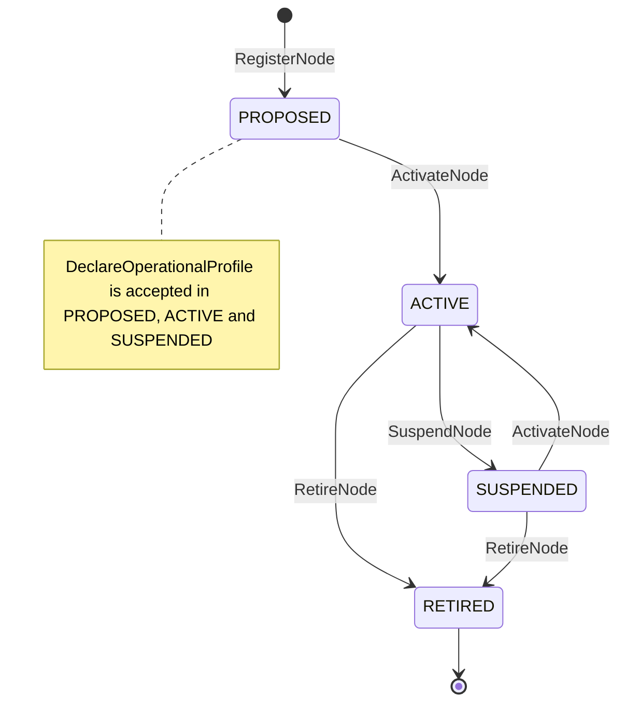
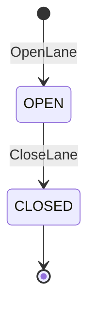
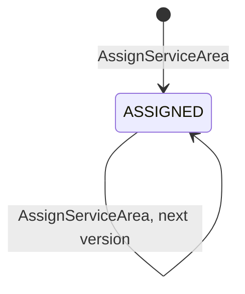
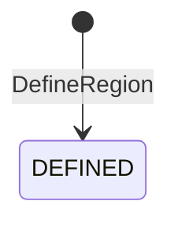

# Aggregate Design Canvas

Following the ddd-crew [Aggregate Design Canvas v1.1](https://github.com/ddd-crew/aggregate-design-canvas).
The context has four aggregate roots: **Node**, **Lane**,
**ServiceArea** and **Region** (one Go package each under `internal/domain`).
Each section below is one canvas. The throughput and size figures are design
estimates; nothing in the repository measures them.

## Node

### 1. Name

`Node` (package `internal/domain/node`), identified by `nodeId`.

### 2. Description

One physical building in the network: its type, operator, region, time zone
and declared operational profile. It holds no child entity. Its value
objects are:

| Value object | Fields |
| --- | --- |
| `OperationalProfile` | one immutable revision: a `ProfileDeclaration` (`Revision`, `Timezone`, `OperatingHours`, `Holidays`, `HandlingTimeMinutes`, `Cutoffs`, `ThroughputCap`, `SortDwellMinutes` for sort centres and air hubs only, `Inbound`, `DeclaredBy` = `VENDOR` or `NETWORK_OPS`) plus `DeclaredAt` |
| `OperatingHours` | weekday to `{Start, End}`, times as `HH:mm`; a missing day is closed (wire name `operatingHoursByDay`) |
| `Holidays` | ISO dates; the node is closed all day |
| `CutoffSlot` | `LocalTime` (`HH:mm`), `Days` (default: every operating day), `MaxOrders` (0 = unset) |
| `ThroughputCap` | `Value` (integer above zero), `TimeUnit` (`HOUR` or `DAY`), `Unit` = `ORDER` |
| `InboundLimits` | optional `MaxCartonWeightG`, `MaxCartonDimsMm{L, W, H}`, `AcceptsPallets`, `RequiresSscc` ([ADR 0007](/docs/adr/0007-inbound-limits-on-the-operational-profile)) |
| `Capabilities` | `Outbound`, `Inbound`, `Returns`, `Sort`, `LastMile`, `Air`; derived from the type, not stored |
| `GeoLocation` | `PostalCode`, `CountryCode`, optional `Lat` and `Lon` (both or neither) |
| `VendorRef` | `VendorID`, `VendorNodeCode` |

### 3. State Transitions

Source: `internal/domain/node/node.go`, `internal/domain/lane/lane.go`, `internal/domain/servicearea/servicearea.go`, `internal/domain/region/region.go`.

Omitted: the transition table (`transitions` in `types.go`) has no row into
`PROPOSED`; it is drawn as the entry state because `RegisterNode` is the only
creating command. `DeclareOperationalProfile` does not change the state, so it
is a note rather than an edge; it is refused on a `RETIRED` node by
`ErrNodeRetired`. Any other move (for example `SuspendNode` on a `PROPOSED`
node) is `illegal-transition`; every command on a `RETIRED` node is
`node-retired`.

### 4. Enforced Invariants

| Invariant | Enforced by |
| --- | --- |
| The operator must be allowed for the node type; parcel nodes are `NETWORK`-operated | `RegisterNode` → `ErrOperatorNotAllowedForNodeType` |
| `vendorNodeCode` is unique per vendor | `RegisterNode` → `ErrVendorNodeCodeTaken` (spans all `Node` aggregates; backed by a unique index, see [Entity Relationship](/docs/ddd/entity-relationship)) |
| The profile revision strictly increases | `DeclareOperationalProfile` → `ErrStaleProfileRevision` |
| A `FULFILLMENT_CENTER` profile declares at least one cutoff and a `handlingTime` above zero before activation, and every later revision of an `ACTIVE` `FULFILLMENT_CENTER` keeps both | `ActivateNode`, `DeclareOperationalProfile` → `ErrIncompleteOperationalProfile` |
| Every day of a cutoff falls inside the operating hours of that day | `DeclareOperationalProfile` → `ErrCutoffOutsideOperatingHours` |
| The node's `regionId` names a defined `Region` | `RegisterNode` → `region.ErrUnknownRegion` |
| `subtype`, when given, is one of the node type's subtypes in `typeRules` | `RegisterNode` → `ErrSubtypeNotAllowed` |
| `sortDwellMinutes` is declared only by `SORTATION_CENTER` and `AIR_HUB` nodes | `DeclareOperationalProfile` → `ErrSortDwellNotAllowed` |
| A `NETWORK` node's profile is never declared by `VENDOR` | `DeclareOperationalProfile` → `ErrValidation` (422 `validation-failed`) |
| Every value rule of the profile (time zone, `HH:mm` times, positive cap, inbound limits) | `NewOperationalProfile` → `ErrValidation` |
| `RETIRED` is terminal | `ActivateNode`, `SuspendNode`, `RetireNode`, `DeclareOperationalProfile` → `ErrNodeRetired` |

### 5. Corrective Policies

The first two policies are enforced in this repository; the rest run in the
named neighbour and are listed from the network model.

- **`DefaultCapabilitiesByType`** (this context): node capabilities are
  derived from the node type, never typed by hand (`Type.Capabilities()` over
  the `typeRules` table).
- **`SuspendedEndpointsUnusable`** (this context): suspending or retiring a
  node closes nothing. Its `OPEN` lanes and `ASSIGNED` service areas stay as
  they are, and consumers treat them as unusable while the node is not
  `ACTIVE` (they react to `NodeSuspended` and `NodeRetired`).
- **`SuppressOnNodeUnavailable`** (`offer-availability`): on `NodeSuspended`
  or `NodeRetired` every listing of the node is suppressed; on
  `NodeActivated` the listings suppressed for that reason are restored.
- **`PickupFromCutoffs`** (`linehaul-transportation`): on
  `NodeOperationalProfileDeclared` the pickup departures for every cutoff of
  the horizon are (re)generated; on `NodeSuspended` or `NodeRetired` future
  pickups are cancelled.
- **`RepromiseOnRisk`** (`delivery-promise`): a cancelled departure on a
  promise's witness path, for example a pickup cancelled after a suspension,
  makes the promise be recomputed and revised.
- **Demand only while `ACTIVE`** (business decision 2): `delivery-promise`
  and `order-sourcing` read node status from their own `NodeProfileView`, so
  a node that is not `ACTIVE` stops being a witness or a candidate without
  any call to this context.

### 6. Handled Commands

| Command | Inbound route | Issued by |
| --- | --- | --- |
| `RegisterNode` | `POST /nodes` | `vendor-connectivity` (vendor node), network-ops planner (network node) |
| `DeclareOperationalProfile` | `PUT /nodes/{nodeId}/operational-profile` | `vendor-connectivity` (`declaredBy` `VENDOR`), network-ops planner (`declaredBy` `NETWORK_OPS`) |
| `ActivateNode` | `POST /nodes/{nodeId}/activations` | network-ops planner |
| `SuspendNode` | `POST /nodes/{nodeId}/suspensions` | network-ops planner |
| `RetireNode` | `POST /nodes/{nodeId}/retirements` | network-ops planner |

### 7. Created Events

| Event | Raised when | Full CloudEvents type |
| --- | --- | --- |
| `NodeRegistered` | `RegisterNode` is saved (state `PROPOSED`) | `com.retailnetwork.logistics.node-topology.node.NodeRegistered` |
| `NodeOperationalProfileDeclared` | a new profile revision is saved | `com.retailnetwork.logistics.node-topology.node.NodeOperationalProfileDeclared` |
| `NodeActivated` | `ActivateNode` is saved (from `PROPOSED` or `SUSPENDED`) | `com.retailnetwork.logistics.node-topology.node.NodeActivated` |
| `NodeSuspended` | `SuspendNode` is saved | `com.retailnetwork.logistics.node-topology.node.NodeSuspended` |
| `NodeRetired` | `RetireNode` is saved | `com.retailnetwork.logistics.node-topology.node.NodeRetired` |

### 8. Throughput

*Estimate*: low, tens of writes per day. Contention on one node is
practically nil: a vendor's profile declaration and a planner's state change
can race, which the optimistic-concurrency version check resolves: the loser
gets `409 concurrent-update`, and the write use cases retry the unit once more
before surfacing it (`transact` in `internal/application/usecases/writer.go`).

### 9. Size

*Estimate* (model): one row plus one profile row per revision; about 10^3
nodes. Events per node over its life: one `NodeRegistered`, one
`NodeOperationalProfileDeclared` per revision, and a handful of
activations, suspensions and one retirement.

## Lane

### 1. Name

`Lane` (package `internal/domain/lane`), identified by `laneId`.

### 2. Description

A directed, mode-specific connection between two nodes with a nominal
transit time. Its scheduled departures belong to `linehaul-transportation`.
Value objects: the nominal transit in minutes (`NominalTransitMinutes`, 1 or
more) and `lane.Mode` (`GROUND` or `AIR`).

### 3. State Transitions

Source: `internal/domain/node/node.go`, `internal/domain/lane/lane.go`, `internal/domain/servicearea/servicearea.go`, `internal/domain/region/region.go`.

Omitted: nothing. There is no reopen; a new lane is opened instead.

### 4. Enforced Invariants

| Invariant | Enforced by |
| --- | --- |
| Origin and destination differ | `OpenLane` → `ErrLaneLoop` |
| (origin type, destination type) is an allowed pair (`allowedPairs`, ten pairs) | `OpenLane` → `ErrLaneTypePairNotAllowed` |
| Both ends are `ACTIVE` when opening | `OpenLane` → `ErrLaneEndpointNotActive` (reads both `Node` aggregates) |
| At most one `OPEN` lane per (origin, destination, mode) | `OpenLane` → `ErrDuplicateLane` (spans `Lane` aggregates; backed by a partial unique index) |

### 5. Corrective Policies

- **`SuspendedEndpointsUnusable`** (this context, see [Node](#node)): the
  `OPEN` lanes of a suspended or retired node are not closed; consumers
  treat them as unusable while an endpoint is not `ACTIVE`.
- Consumers react: `linehaul-transportation` refuses to schedule on a closed
  lane (`ErrLaneClosed`, its own invariant) and keeps a `LaneView`;
  `delivery-promise` and `order-sourcing` keep `LaneView` and
  `NetworkGraphView`.

### 6. Handled Commands

| Command | Inbound route | Issued by |
| --- | --- | --- |
| `OpenLane` | `POST /lanes` | network-ops planner |
| `CloseLane` | `POST /lanes/{laneId}/closures` | network-ops planner |

### 7. Created Events

| Event | Raised when | Full CloudEvents type |
| --- | --- | --- |
| `LaneOpened` | `OpenLane` is saved | `com.retailnetwork.logistics.node-topology.lane.LaneOpened` |
| `LaneClosed` | `CloseLane` is saved | `com.retailnetwork.logistics.node-topology.lane.LaneClosed` |

### 8. Throughput

*Estimate*: low.

### 9. Size

*Estimate*: about 10^4 lanes. Two events per lane over its life.

## ServiceArea

### 1. Name

`ServiceArea` (package `internal/domain/servicearea`), identified by
`postalPrefix`.

### 2. Description

Which delivery station (and therefore which region) serves a postal prefix,
versioned by `assignmentVersion`.

### 3. State Transitions

Source: `internal/domain/node/node.go`, `internal/domain/lane/lane.go`, `internal/domain/servicearea/servicearea.go`, `internal/domain/region/region.go`.

`ServiceArea` has one state, `ASSIGNED`, which is also its
initial state, and one transition: `ASSIGNED` → `ASSIGNED` on
`AssignServiceArea` (`servicearea.Assign` for the first version,
`Reassign` after). A prefix is reassigned to another station under a higher
`assignmentVersion` (`ErrStaleAssignmentVersion`). There is no unassign. The
prefix is 1 to 16 characters from `A-Z`, `0-9` and `-`, matched exactly.

Omitted: nothing.

### 4. Enforced Invariants

| Invariant | Enforced by |
| --- | --- |
| The assigned node is an `ACTIVE` `DELIVERY_STATION` | `AssignServiceArea` → `ErrNotADeliveryStation` (reads the `Node` aggregate) |
| The assignment version strictly increases | `AssignServiceArea` → `ErrStaleAssignmentVersion` |
| The assigned region is a defined `Region` and matches the station's region | `AssignServiceArea` → `region.ErrUnknownRegion` (reads the `Region` and `Node` aggregates) |

### 5. Corrective Policies

- **`SuspendedEndpointsUnusable`** (this context, see [Node](#node)): the
  `ASSIGNED` service areas of a suspended or retired station are not
  unassigned; consumers treat them as unusable while the station is not
  `ACTIVE`.
- The region of the prefix is published in `ServiceAreaAssigned` and must
  match the station's `regionId`.
- Consumers react: `delivery-promise` (`RegionAndServiceAreaView`),
  `order-sourcing` (`NetworkGraphView`), `last-mile-delivery`
  (`StationView`).

### 6. Handled Commands

| Command | Inbound route | Issued by |
| --- | --- | --- |
| `AssignServiceArea` | `PUT /service-areas/{postalPrefix}` | network-ops planner |

### 7. Created Events

| Event | Raised when | Full CloudEvents type |
| --- | --- | --- |
| `ServiceAreaAssigned` | each saved assignment version | `com.retailnetwork.logistics.node-topology.servicearea.ServiceAreaAssigned` |

### 8. Throughput

*Estimate*: low; bulk at network redesign.

### 9. Size

*Estimate*: about 10^4 prefixes. One event per assignment version.

## Region

### 1. Name

`Region` (package `internal/domain/region`), identified by
`regionId`.

### 2. Description

A largely self-sufficient partition of the network. Nodes and service areas
belong to exactly one region. A region has a `code` and a `name`.

### 3. State Transitions

Source: `internal/domain/node/node.go`, `internal/domain/lane/lane.go`, `internal/domain/servicearea/servicearea.go`, `internal/domain/region/region.go`.

`DEFINED` is the initial state. Omitted: nothing. There is no rename and
no removal.

### 4. Enforced Invariants

| Invariant | Enforced by |
| --- | --- |
| The region code is unique (1 to 16 characters from `A-Z`, `0-9`, `_`, `-`) | `DefineRegion` → `ErrRegionCodeTaken` (spans `Region` aggregates; backed by the unique constraint `regions_code_key`) |

### 5. Corrective Policies

None.

### 6. Handled Commands

| Command | Inbound route | Issued by |
| --- | --- | --- |
| `DefineRegion` | `POST /regions` | network-ops planner |

### 7. Created Events

| Event | Raised when | Full CloudEvents type |
| --- | --- | --- |
| `RegionDefined` | `DefineRegion` is saved | `com.retailnetwork.logistics.node-topology.region.RegionDefined` |

### 8. Throughput

*Estimate*: rare.

### 9. Size

*Estimate*: single digits (eight in the reference network). One
event per region.

## Read models

The context has **no read model** of its own. The six query routes
(`GET /nodes/{nodeId}` is `GetNode`, `GET /nodes?type=&region=&status=`
is `ListNodes`, `GET /lanes?origin=&destination=` is `ListLanes`,
`GET /service-areas/{postalPrefix}` is `ResolveServiceArea`, `GET /regions`
is `ListRegions` and `GET /regions/{regionId}` is `GetRegion`) read
the aggregates' own tables directly through the repositories; the MCP tools
and A2A skills use the same query use cases. That is enough here because:

- the write rate is low, so the query load never contends with writes;
- each query is a lookup or a filter on one aggregate type, never a join of
  facts from several contexts;
- the neighbours that need these facts on a hot path keep their own
  event-fed read models (`NodeProfileView`, `LaneView`,
  `RegionAndServiceAreaView`, `NetworkGraphView`, `NodeStatusView`,
  `VendorNodeView`, `StationView`), so this context is never on that path.

The three uniqueness rules that span aggregates (`ErrVendorNodeCodeTaken`,
`ErrDuplicateLane`, `ErrRegionCodeTaken`) are enforced by unique indexes in
the same database, with a pre-check in the use case for a friendly error, not
by a read model and not by a bigger aggregate.

## Inbound limits and the INBOUND capability

Inbound limits are built as [ADR 0007](/docs/adr/0007-inbound-limits-on-the-operational-profile)
decided; where the network design wanted more, the text below says so.

- `OperationalProfile` carries an optional `Inbound` (`InboundLimits`:
  `MaxCartonWeightG`, `MaxCartonDimsMm{L, W, H}`, `AcceptsPallets`,
  `RequiresSscc`). Like the rest of the profile it is versioned by the profile
  revision and never edited in place.
- The designed invariant `ErrInboundLimitsNotAllowed` (`inbound` only for nodes
  with the `INBOUND` capability) is **not built**. The limits are value-checked
  only, with `ErrValidation` (422 `validation-failed`): every number set is a
  positive integer, the three `maxCartonDimsMm` edges are all-or-none, and an
  `inbound` that declares nothing is refused. Any node type may declare them.
- By design `FULFILLMENT_CENTER` has the `INBOUND` capability as well as
  `OUTBOUND`, because a seller's cartons are received at the building that
  stores them; `INBOUND_CROSS_DOCK` already had it. As built, `typeRules`
  still gives `FULFILLMENT_CENTER` only `OUTBOUND` (`internal/domain/node/types.go`),
  so `GET /nodes/{nodeId}` reports `inbound: false` for it, while
  `seller-inbound` treats both types as receiving nodes (the network model's
  gap G64).
- `NodeOperationalProfileDeclared` carries `inbound`. `seller-inbound` keeps it
  in `NodeInboundView` and checks carton weight and size against it;
  `node-topology` does not know sellers.
