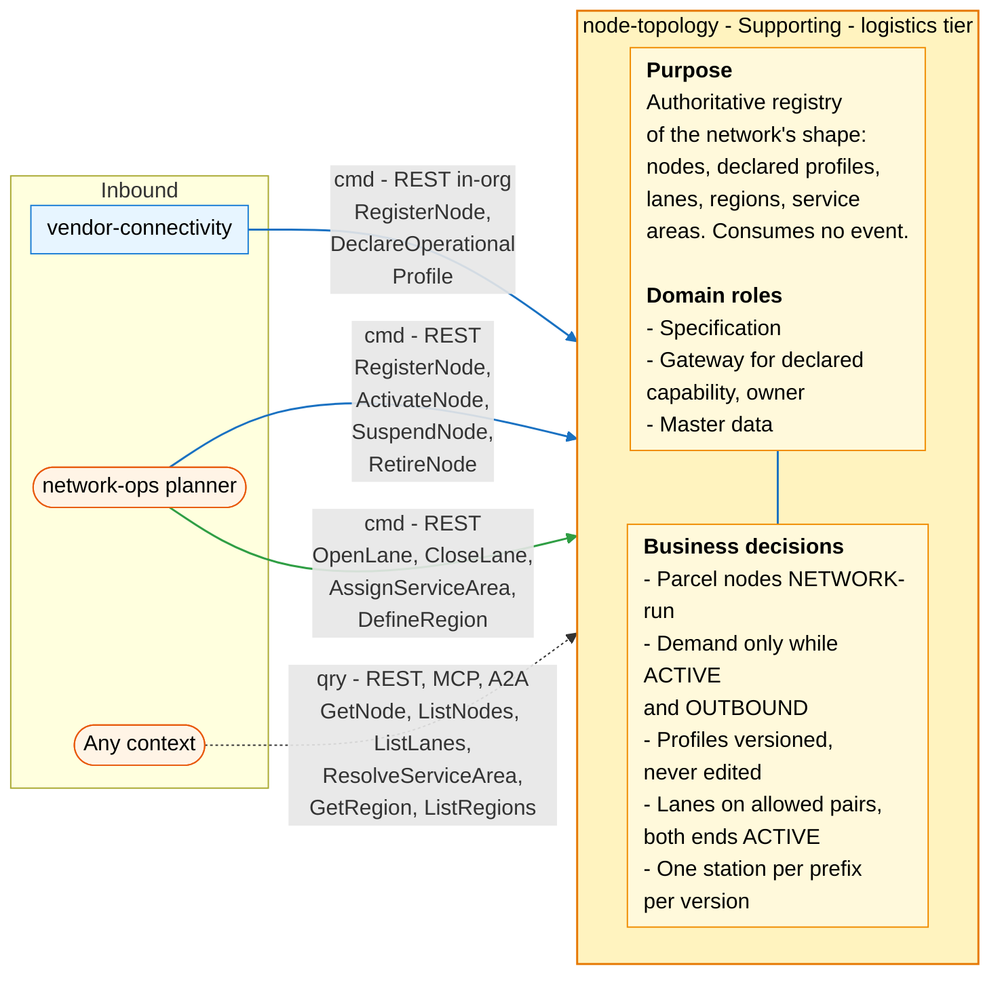
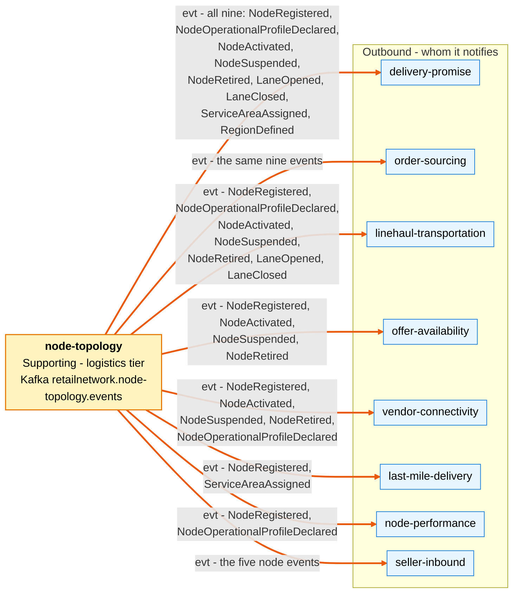

# Bounded Context Canvas

Following the ddd-crew [Bounded Context Canvas v5](https://github.com/ddd-crew/bounded-context-canvas).
Every inbound row comes from the operations of `apis/openapi.yaml` and the
routes in `internal/adapters/inbound/http/server.go`; every outbound row from
the nine event types of `apis/asyncapi.yaml`, with the subscribers taken from
the network model (this repository cannot see its consumers).

## Canvas at a glance

Two pictures of the sections below, laid out like the ddd-crew canvas: first
the inbound collaborators (with the purpose, domain roles and business
decisions of this context), then the outbound collaborators it notifies.
Arrows follow the message type: **solid blue** commands (`cmd`), **dotted
green** queries (`qry`), **thick orange** events (`evt`). Box shapes mark the
collaborator kind: rounded = people or any client; blue = sibling bounded
context. Path parameters are written without braces inside the diagrams.

### Inbound

Source: `internal/adapters/inbound/http/server.go`, `internal/adapters/inbound/http/problems.go`, `internal/adapters/outbound/kafka/encoder.go`, `apis/openapi.yaml`, `apis/asyncapi.yaml`.

### Outbound

Source: `internal/adapters/outbound/kafka/encoder.go`, `internal/adapters/outbound/kafka/payloads.go`, `apis/asyncapi.yaml`; subscribers from the network model.

The diagrams omit: assumptions, verification metrics, open questions and the
ubiquitous language (sections below); the relationship pattern per message
(see the tables); the full CloudEvents types (see the Outbound table); and
`customer-ordering` and `shipping-and-tracking`, which have no edge to this
context. There is no outbound command or query: the context calls nobody.

## Name

**Node Topology** (`node-topology`, code `NT`, CloudEvents tier `logistics`).

## Purpose

To be the authoritative registry of the network's physical shape:

- every node: vendor fulfillment centres, inbound cross-docks and returns
  centres, and the network's own sortation centres, delivery stations and air
  hubs;
- each node's declared operational profile, versioned;
- the directed lanes between nodes;
- the regions;
- which delivery station serves which postal prefix.

It holds declared facts. It does not schedule, promise, assign or measure.

## Strategic Classification

| Axis | Verdict |
| --- | --- |
| **Domain** | **Supporting**. See [Core Domain Chart](/docs/ddd/core-domain-chart). |
| **Business Model** | Enabler: every promise, assignment and route rests on it. |
| **Evolution** | Custom-built. The operational profile is shaped after a Product surface (the supply-source (multi-location inventory) API, see the vendor platform API surface map). |

## Domain Roles

| Role | Applies? | Evidence |
| --- | --- | --- |
| **Specification** | Yes, primary | It specifies the shape every other logistics decision works within: node types, allowed lane pairs, service areas. |
| **Gateway for declared capability (owner)** | Yes | Vendors' declarations (`DeclareOperationalProfile`, `declaredBy: VENDOR`) arrive here, through `vendor-connectivity`, and leave as `NodeOperationalProfileDeclared`. |
| **Master data** | Yes | Low write rate, many readers: nine events, eight subscribing contexts, six read operations for any caller. |
| Execution, Analysis, Enforcer | No | It makes no per-order decision and measures nothing. |

## Inbound Communication

| Collaborator | Message | Type | Channel | Relationship |
| --- | --- | --- | --- | --- |
| `vendor-connectivity` | `RegisterNode` (vendor node) | Command | REST `POST /nodes` (in-org) | Customer/Supplier (this context is the Supplier) |
| `vendor-connectivity` | `DeclareOperationalProfile` | Command | REST `PUT /nodes/{nodeId}/operational-profile` (in-org) | Customer/Supplier |
| network-ops planner | `RegisterNode` (network node) | Command | REST `POST /nodes` | UI |
| network-ops planner | `ActivateNode` | Command | REST `POST /nodes/{nodeId}:activate` | UI |
| network-ops planner | `SuspendNode` | Command | REST `POST /nodes/{nodeId}:suspend` | UI |
| network-ops planner | `RetireNode` | Command | REST `POST /nodes/{nodeId}:retire` | UI |
| network-ops planner | `OpenLane` | Command | REST `POST /lanes` | UI |
| network-ops planner | `CloseLane` | Command | REST `POST /lanes/{laneId}:close` | UI |
| network-ops planner | `AssignServiceArea` | Command | REST `PUT /service-areas/{postalPrefix}` | UI |
| network-ops planner | `DefineRegion` | Command | REST `POST /regions` | UI |
| Any context | `GetNode` | Query | REST `GET /nodes/{nodeId}` | Open Host Service |
| Any context | `ListNodes` | Query | REST `GET /nodes?type=&region=&status=`; MCP `list_nodes`; A2A `find_nodes` | Open Host Service |
| Any context | `ListLanes` | Query | REST `GET /lanes?origin=&destination=`; MCP `list_lanes` | Open Host Service |
| Any context | `ResolveServiceArea` | Query | REST `GET /service-areas/{postalPrefix}`; MCP `resolve_service_area`; A2A `serving_station` | Open Host Service |
| Any context | `ListRegions`, `GetRegion` | Query | REST `GET /regions`, `GET /regions/{regionId}`; MCP `list_regions`, `get_region` | Open Host Service |

No inbound event: the context consumes no topic ([ADR 0003](/docs/adr/0003-no-consumed-contracts-and-ohs-reads)).
No neighbour is known to call the read routes synchronously; the only
synchronous caller is `vendor-connectivity`, with the two commands above. The
MCP server and the A2A agent are separate read-only binaries over the same query
use cases ([MCP tools](/docs/mcp/tools), [API overview](/docs/api-reference)).

## Outbound Communication

Every event goes to topic `retailnetwork.node-topology.events`, source
`/retailnetwork/node-topology`, through a transactional outbox.

| Collaborator | Message | Type | Channel | Relationship |
| --- | --- | --- | --- | --- |
| `offer-availability`, `delivery-promise`, `order-sourcing`, `linehaul-transportation`, `last-mile-delivery`, `node-performance`, `vendor-connectivity`, `seller-inbound` | `NodeRegistered` | Event | `retailnetwork.node-topology.events`, `com.retailnetwork.logistics.node-topology.node.NodeRegistered` | Open Host Service + Published Language (consumers Conformist) |
| `delivery-promise`, `order-sourcing`, `linehaul-transportation`, `node-performance`, `vendor-connectivity`, `seller-inbound` | `NodeOperationalProfileDeclared` | Event | `retailnetwork.node-topology.events`, `com.retailnetwork.logistics.node-topology.node.NodeOperationalProfileDeclared` | OHS + PL (Conformist) |
| `offer-availability`, `delivery-promise`, `order-sourcing`, `linehaul-transportation`, `vendor-connectivity`, `seller-inbound` | `NodeActivated` | Event | `retailnetwork.node-topology.events`, `com.retailnetwork.logistics.node-topology.node.NodeActivated` | OHS + PL (Conformist) |
| `offer-availability`, `delivery-promise`, `order-sourcing`, `linehaul-transportation`, `vendor-connectivity`, `seller-inbound` | `NodeSuspended` | Event | `retailnetwork.node-topology.events`, `com.retailnetwork.logistics.node-topology.node.NodeSuspended` | OHS + PL (Conformist) |
| `offer-availability`, `delivery-promise`, `order-sourcing`, `linehaul-transportation`, `vendor-connectivity`, `seller-inbound` | `NodeRetired` | Event | `retailnetwork.node-topology.events`, `com.retailnetwork.logistics.node-topology.node.NodeRetired` | OHS + PL (Conformist) |
| `linehaul-transportation`, `delivery-promise`, `order-sourcing` | `LaneOpened` | Event | `retailnetwork.node-topology.events`, `com.retailnetwork.logistics.node-topology.lane.LaneOpened` | OHS + PL (Conformist) |
| `linehaul-transportation`, `delivery-promise`, `order-sourcing` | `LaneClosed` | Event | `retailnetwork.node-topology.events`, `com.retailnetwork.logistics.node-topology.lane.LaneClosed` | OHS + PL (Conformist) |
| `delivery-promise`, `order-sourcing`, `last-mile-delivery` | `ServiceAreaAssigned` | Event | `retailnetwork.node-topology.events`, `com.retailnetwork.logistics.node-topology.servicearea.ServiceAreaAssigned` | OHS + PL (Conformist) |
| `delivery-promise`, `order-sourcing` | `RegionDefined` | Event | `retailnetwork.node-topology.events`, `com.retailnetwork.logistics.node-topology.region.RegionDefined` | OHS + PL (Conformist) |

No outbound command or query: the context calls nobody. Full payloads:
[Domain Events](/docs/ddd/domain-events). Relationship
reasoning: [Context Map](/docs/ddd/context-map).

## Ubiquitous Language

Full glossary: [Ubiquitous Language](/docs/ddd/ubiquitous-language).
Top terms: **Node**, **Node Type**, **Node Operator**, **Operational
Profile** (versioned by `profileRevision`), **Cutoff**, **Handling Time**,
**Throughput Cap**, **Lane**, **Region**, **Service Area**.

## Business Decisions

1. **Parcel nodes are network-operated.** A `SORTATION_CENTER`,
   `DELIVERY_STATION` or `AIR_HUB` always has operator `NETWORK`; a vendor
   registers only `FULFILLMENT_CENTER`, `INBOUND_CROSS_DOCK` or
   `RETURNS_CENTER` (`ErrOperatorNotAllowedForNodeType`).
2. **Demand only while `ACTIVE` and `OUTBOUND`.** Capabilities come from the
   node type (`DefaultCapabilitiesByType`). The decision is applied by the
   consumers (`offer-availability` suppresses listings on a non-`ACTIVE`
   node, `delivery-promise` and `order-sourcing` read node status from
   their `NodeProfileView`).
3. **Profiles are versioned, never edited.** `profileRevision` strictly
   increases (`ErrStaleProfileRevision`). A `FULFILLMENT_CENTER` needs at
   least one cutoff and a `handlingTime` above zero before activation
   (`ErrIncompleteOperationalProfile`), and every cutoff falls inside the
   operating hours of its day (`ErrCutoffOutsideOperatingHours`).
4. **Lanes follow the allowed type pairs, and both ends are `ACTIVE` when
   opened.** `ErrLaneLoop`, `ErrLaneTypePairNotAllowed`,
   `ErrLaneEndpointNotActive`; at most one `OPEN` lane per origin,
   destination and mode (`ErrDuplicateLane`).
5. **One delivery station per postal prefix per assignment version.**
   `ErrNotADeliveryStation`, `ErrStaleAssignmentVersion`.
6. **`RETIRED` is terminal** (`ErrNodeRetired`).

## Assumptions

- Vendors never call this context directly. Every vendor node arrives
  through `vendor-connectivity`, which has already checked that the vendor
  acts on its own nodes (`ErrNodeNotOwnedByVendor` is enforced there).
- Write volume stays low (tens of node writes a day; lane and service-area
  bulk loads only at network redesign), so a single writer per aggregate and
  optimistic concurrency are enough.
- Consumers keep their own read models from the events and never need a
  synchronous read on their hot path ([ADR 0003](/docs/adr/0003-no-consumed-contracts-and-ohs-reads)).
- The reference network has single-digit regions (eight in the network
  model's size estimate).

## Verification Metrics

What is instrumented: the counter `topology.nodes.registered` (attributes
`outcome` = `registered` or `rejected`, and `reason` = the problem slug on a
rejection), plus the standard HTTP server metrics and request logs (see
[Observability](/docs/operations/observability)). Because the `reason` of a
rejected registration is the problem slug, **refused parcel registrations**
(`operator-not-allowed-for-node-type`) and `vendor-node-code-taken` can be read
from it.

Measures worth having that the service does **not** record today:

- **Event lag**: time from a committed write to the outbox row being published
  on `retailnetwork.node-topology.events`, p95 (the relay logs failures but
  exposes no lag instrument).
- **Pickup coverage**: share of cutoffs of `ACTIVE` vendor
  `FULFILLMENT_CENTER` nodes for which `linehaul-transportation` has a pickup
  departure on the next operating day; it lives in the consumer.
- **Unserved prefixes**: postal prefixes resolved by
  `GET /service-areas/{postalPrefix}` with a 404, per day (derivable from the
  HTTP server metrics).
- **Stale-write rate**: `stale-profile-revision` and
  `stale-assignment-version` responses per day (a high rate means callers race
  each other).

## Open Questions

Questions the design once left open and the code has since answered:

- **Who declares a network node's profile?** Both: `declaredBy` is `VENDOR` or
  `NETWORK_OPS`, and a `NETWORK` node refuses `VENDOR` as declarer
  (`ErrValidation`).
- **A new profile on an `ACTIVE` fulfillment centre.** It must keep at least one
  cutoff and a handling time above zero (`ErrIncompleteOperationalProfile`).
- **Cutoffs and days.** `CutoffSlot` carries optional `Days`; empty means every
  operating day, and the cutoff must fall inside the hours of each of them.
- **Region membership.** It is checked: `RegisterNode` and `AssignServiceArea`
  refuse an unknown region (`unknown-region`, 422), and a service area's region
  must equal its station's.
- **Not-found and illegal transitions.** They have shared problem types:
  `not-found` (404) and `illegal-transition` (409), plus `node-retired`.

Still open:

- **Lanes and service areas after a node leaves service.** When a node is
  suspended or retired, its lanes stay `OPEN` and the prefixes assigned to a
  retired delivery station stay `ASSIGNED` (policy `SuspendedEndpointsUnusable`).
  Nothing closes or reassigns them; consumers must treat them as unusable.
- **The `INBOUND` capability of `FULFILLMENT_CENTER`** and the gate
  `ErrInboundLimitsNotAllowed` are not built (gap G64; see the
  [Aggregate Design Canvas](/docs/ddd/aggregate-design-canvas#inbound-limits-and-the-inbound-capability)).
