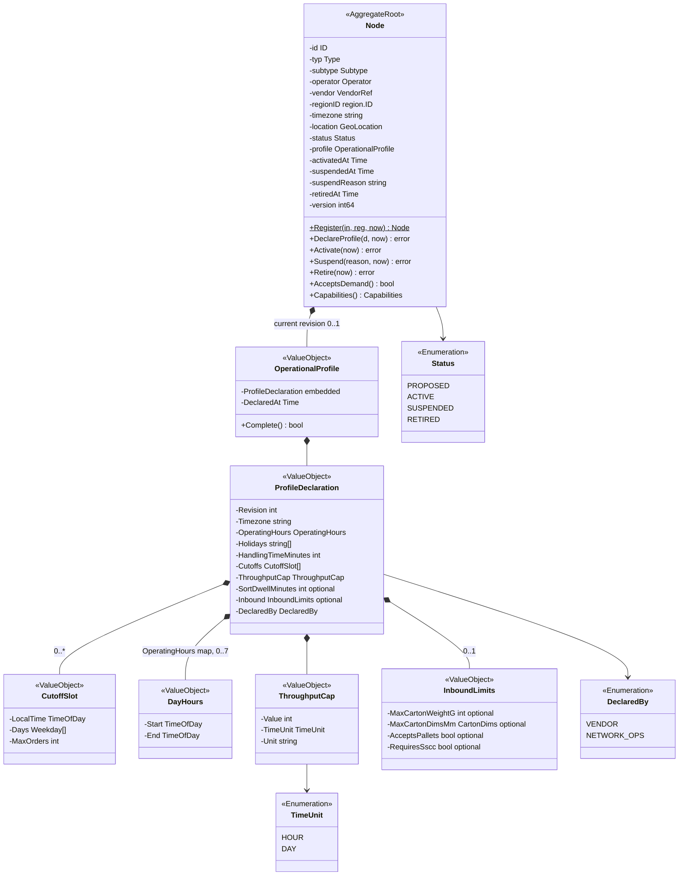
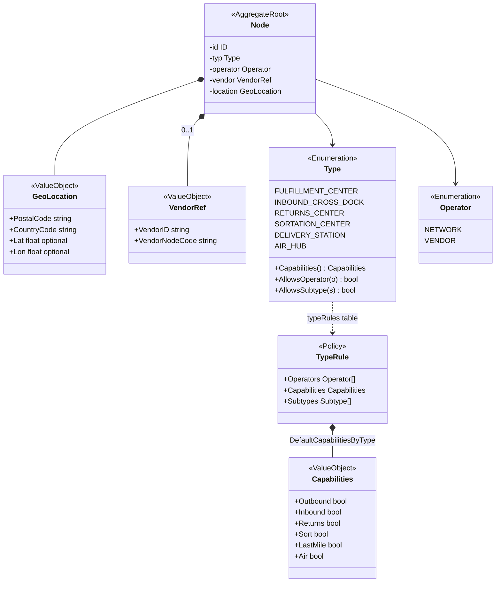
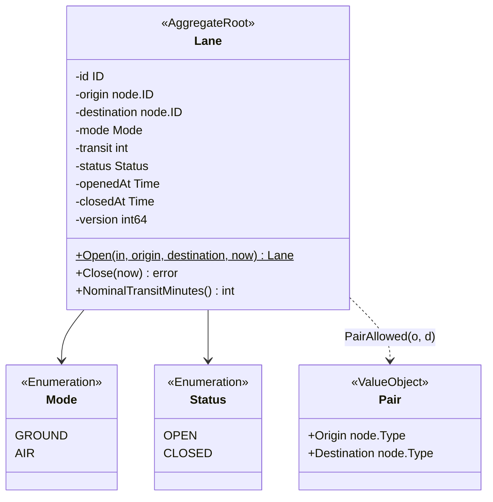
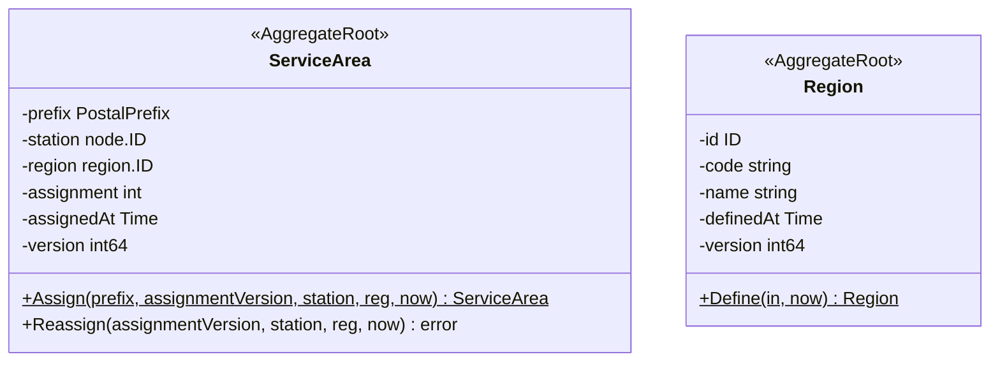
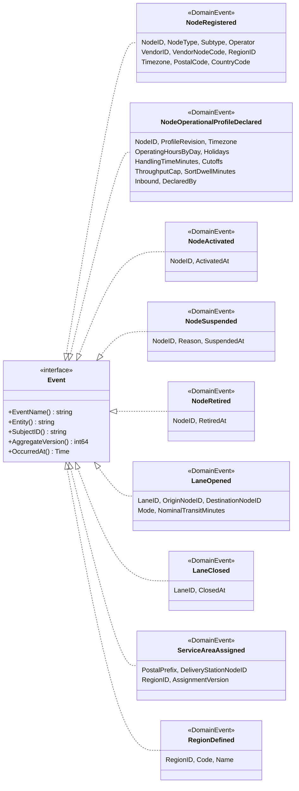
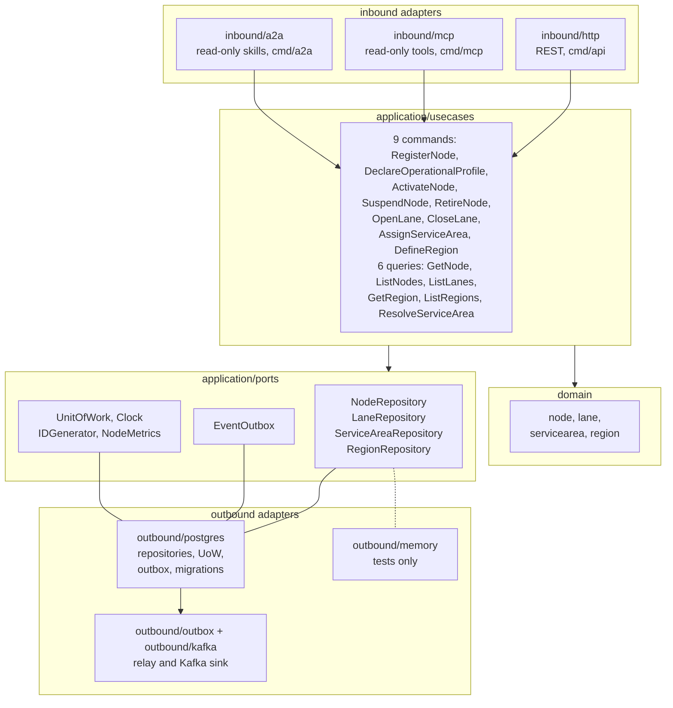

# Class Diagram

UML class diagrams of the domain model as built, in the Go hexagonal layout the
warehouse-systems fleet uses. Type names are the Go identifiers in
`internal/domain` (`node.Node`, `node.OperationalProfile`, `node.CutoffSlot`,
`node.ThroughputCap`, `lane.Lane`, `region.Region`,
`servicearea.ServiceArea`). Fields are unexported (`-`), methods exported
(`+`). Only state-changing methods and key queries are shown. Every state
change returns the raised events (`[]shared.Event`) and an error.

## 1. Node aggregate: root and operational profile

Source: `internal/domain/node/node.go`, `profile.go`, `inbound.go`, `types.go`.

Omitted: the read accessors and the `Err...` variables (on
[Aggregate Design Canvas](/docs/ddd/aggregate-design-canvas)); `Snapshot`,
`Restore` and `Registration`, the persistence and input structs. The aggregate
holds only the **current** profile; the repository stores every past revision as
its own immutable row, which the aggregate never edits. `OperatingHours` is the
map `Weekday` to `DayHours` (`HH:mm`); a missing day is closed. `CutoffSlot.Days`
empty means every operating day; `MaxOrders` 0 means unset. `SortDwellMinutes`
is set only on `SORTATION_CENTER` and `AIR_HUB` nodes. `version` is the
optimistic-concurrency counter, not a domain field.

## 2. Node aggregate: identity, capabilities and type rules

Source: `internal/domain/node/types.go`, `node.go`.

Omitted: the fields already shown in diagram 1; the enumeration `Subtype`
(seven fulfillment-centre subtypes), listed on
[Ubiquitous Language](/docs/ddd/ubiquitous-language). `VendorRef` is absent on
a `NETWORK` node. Capabilities are not stored in the aggregate: `Capabilities()`
derives them from `Type` through the `typeRules` table (policy
`DefaultCapabilitiesByType`).

## 3. Lane aggregate

Source: `internal/domain/lane/lane.go`.

Omitted: `origin` and `destination` are node ids, not associations to `Node`;
`Open` receives the two loaded `Node` aggregates read-only. The type-pair rule is
the package-level list `allowedPairs` (ten pairs) behind `PairAllowed`, not a
class of its own.

## 4. ServiceArea and Region aggregates

Source: `internal/domain/servicearea/servicearea.go`, `internal/domain/region/region.go`.

Omitted: `station` and `region` are ids, not associations: each aggregate is
loaded and saved on its own, and `Assign` takes the loaded station and region
read-only. `ServiceArea` and `Region` have a single state each (`ASSIGNED`,
`DEFINED`), so no status enumeration exists in code.

## 5. Domain events

Source: `internal/domain/shared/shared.go`, `internal/domain/node/events.go`,
`internal/domain/lane/events.go`, `internal/domain/servicearea/events.go`,
`internal/domain/region/events.go`.

Omitted: field types (the wire shapes are on [Domain Events](/docs/ddd/domain-events)).
`SubjectID()` is the CloudEvents `subject` and the Kafka key; each event embeds
`shared.Header` (`Version`, `At`).

## 6. Hexagonal ports and adapters

Source: `internal/application/ports/ports.go`, `internal/application/usecases/*.go`,
`cmd/api/run.go`, `cmd/mcp/main.go`, `cmd/a2a/main.go`.

Packages, under `internal/`:

| Package | Contents |
| --- | --- |
| `internal/domain/node` | `Node`, `OperationalProfile`, `ProfileDeclaration`, `CutoffSlot`, `ThroughputCap`, `InboundLimits`, `Capabilities`, `GeoLocation`, `VendorRef`, `Type`, `Subtype`, `Operator`, `Status`, the `typeRules` table, the nine `Err...` of `Node` |
| `internal/domain/lane` | `Lane`, `Mode`, `Status`, `Pair`, `allowedPairs`, the four `Err...` of `Lane` |
| `internal/domain/servicearea` | `ServiceArea`, `PostalPrefix`, `ErrNotADeliveryStation`, `ErrStaleAssignmentVersion` |
| `internal/domain/region` | `Region`, `ErrRegionCodeTaken`, `ErrUnknownRegion` |
| `internal/domain/shared` | the `Event` interface, `Header`, `ErrValidation`, `ErrIllegalTransition`, id and text validators |
| `internal/application/usecases` | the nine command use cases and the six query use cases |
| `internal/application/ports` | the four repositories, `EventOutbox`, `UnitOfWork`, `Clock`, `IDGenerator`, `NodeMetrics`, `ErrNotFound`, `ErrConcurrentUpdate` |
| `internal/adapters/inbound/http` | the sixteen REST operations, `/healthz` and `/readyz`, problem+json mapping, `Idempotency-Key` handling |
| `internal/adapters/inbound/mcp`, `inbound/a2a` | the read-only MCP tools and A2A skills, over the six query use cases |
| `internal/adapters/outbound/postgres` | repositories, unit of work, outbox writer and drain, migrations |
| `internal/adapters/outbound/outbox`, `outbound/kafka` | the relay loop; the Kafka writer, encoder and relay sink to `retailnetwork.node-topology.events` |
| `internal/adapters/kafka/cloudevents` | the CloudEvents envelope |
| `internal/adapters/outbound/memory` | in-memory repositories for unit tests; `cmd/**` never imports them (a fitness test pins it) |

Omitted from the diagram: the composition roots (`cmd/`), `outbound/telemetry`,
`outbound/clock`, `outbound/ids`, and the read of a second aggregate (`OpenLane`
and `AssignServiceArea` read `Node` through `NodeRepository`).
