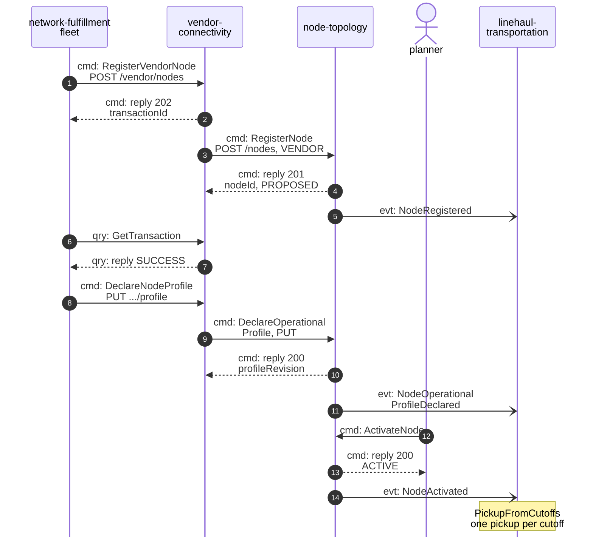
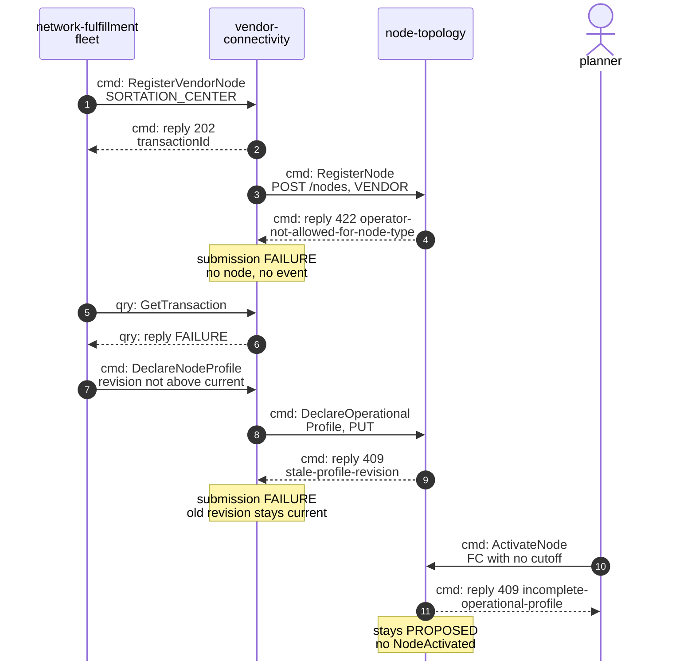
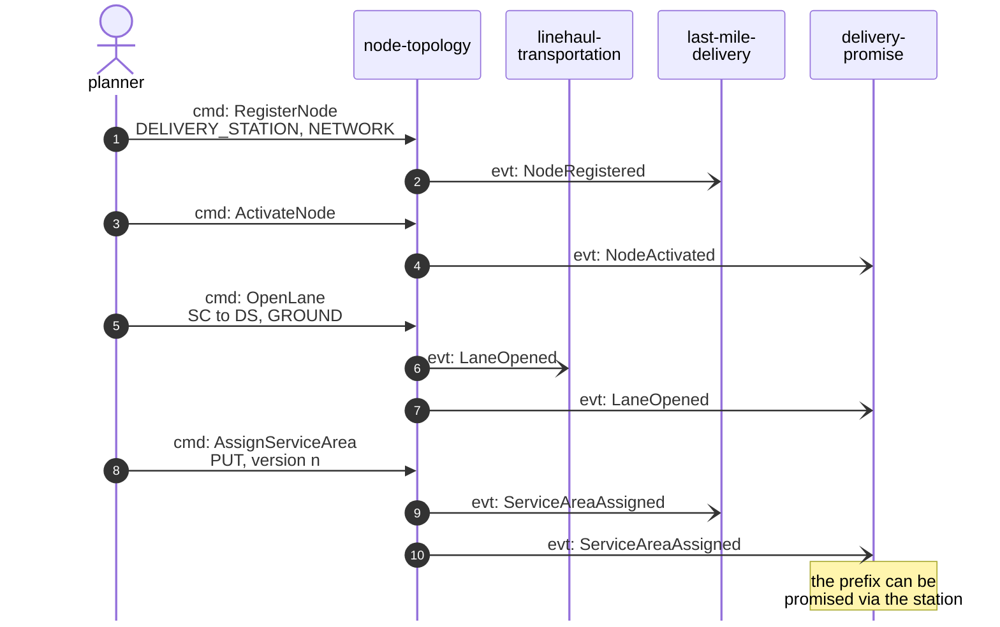
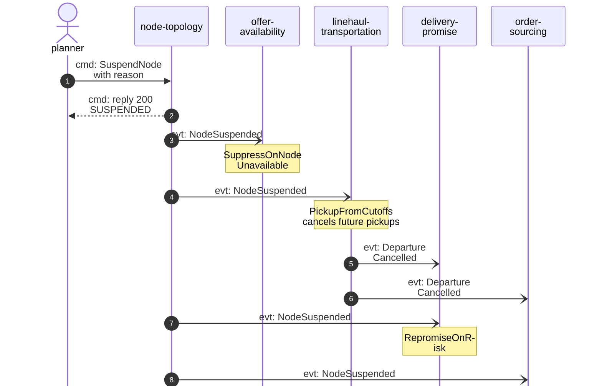

# Domain Message Flow

Following ddd-crew [Domain Message Flow Modelling](https://github.com/ddd-crew/domain-message-flow-modelling).
Participants are contexts and actors. Every arrow is a message of this context's
contracts (`apis/openapi.yaml`, `apis/asyncapi.yaml`) or, for the neighbours'
own steps, of the network model; each is prefixed `cmd:` (command), `qry:`
(query) or `evt:` (event). Events go
through `retailnetwork.node-topology.events`; the diagrams draw them straight
to the consumer. Full CloudEvents types are
`com.retailnetwork.logistics.node-topology.<entity>.<EventName>` (see
[Domain Events](/docs/ddd/domain-events)). Path parameters are
written without braces. The domain-wide flows are on
[Domain Message Flows](https://iqvo.github.io/warehouse-docs/network/strategic-design/domain-message-flows).

## 1. A vendor node joins the network (happy path)

Source: `apis/openapi.yaml`, `apis/asyncapi.yaml`, `internal/application/usecases/*.go`, `internal/adapters/outbound/kafka/encoder.go`.

Omitted: the other consumers of the same events (`NodeRegistered` also goes
to `offer-availability`, `delivery-promise`, `order-sourcing`,
`last-mile-delivery`, `node-performance`, `vendor-connectivity` and
`seller-inbound`; `NodeOperationalProfileDeclared` to `delivery-promise`,
`order-sourcing`, `node-performance`, `vendor-connectivity` and
`seller-inbound`; `NodeActivated` to `offer-availability`,
`delivery-promise`, `order-sourcing`, `vendor-connectivity` and
`seller-inbound`); the second
`GetTransaction` poll after the profile declaration; `vendor-connectivity`'s
own `SubmissionProcessed` event; and the lane from the new node to a
sortation centre, which the planner opens as in scenario 3.

## 2. A vendor write refused, and an incomplete node not activated (failure paths)

Source: `apis/openapi.yaml`, `apis/asyncapi.yaml`, `internal/application/usecases/*.go`, `internal/adapters/outbound/kafka/encoder.go`.

Omitted: `ErrCutoffOutsideOperatingHours`, `region.ErrUnknownRegion`,
`ErrSubtypeNotAllowed` and `ErrSortDwellNotAllowed` (all 422, same shape as
the first branch), and `ErrVendorNodeCodeTaken` (409, same shape as the stale
revision branch). The same incomplete-profile refusal (`ErrIncompleteOperationalProfile`) also
stops a later revision of an `ACTIVE` fulfillment centre that drops every
cutoff or sets `handlingTimeMinutes` to zero. Nothing reaches Kafka from this context on any refusal. The problem
`type` slugs are listed on [Use cases](/docs/ddd/use-cases).

## 3. The planner adds a delivery station and its service area

Source: `apis/openapi.yaml`, `apis/asyncapi.yaml`, `internal/application/usecases/*.go`, `internal/adapters/outbound/kafka/encoder.go`.

Omitted: the replies (201 or 200 with the new state); the other consumers
(`order-sourcing` takes every event shown; `offer-availability`,
`node-performance`, `vendor-connectivity` and `seller-inbound` also take
`NodeRegistered`);
`DefineRegion`, which precedes the station when the region is new; the
branches `ErrLaneEndpointNotActive` (opening the lane before activation) and
`ErrNotADeliveryStation` (assigning to a node that is not an `ACTIVE`
station), both 409.

## 4. A node is suspended

Source: `apis/openapi.yaml`, `apis/asyncapi.yaml`, `internal/application/usecases/*.go`, `internal/adapters/outbound/kafka/encoder.go`.

Omitted: `vendor-connectivity` (its `VendorNodeView`) and `seller-inbound` also consume `NodeSuspended`; the listing events `offer-availability` then publishes
(`ListingSuppressed`); the reactivation path (`ActivateNode` from
`SUSPENDED`, `NodeActivated`, listings restored). The node's lanes stay
`OPEN` and its assigned service areas stay `ASSIGNED`: policy
`SuspendedEndpointsUnusable` closes nothing, and consumers treat them as
unusable while the node is not `ACTIVE`.
