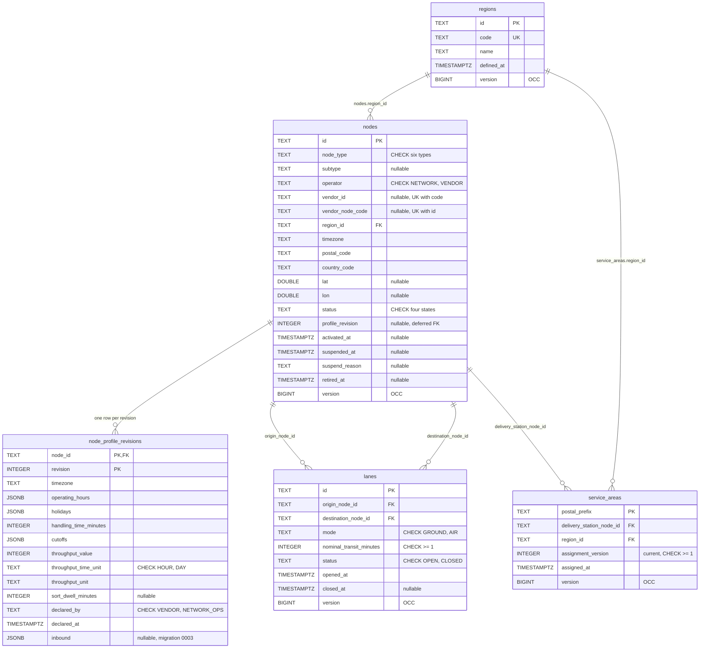
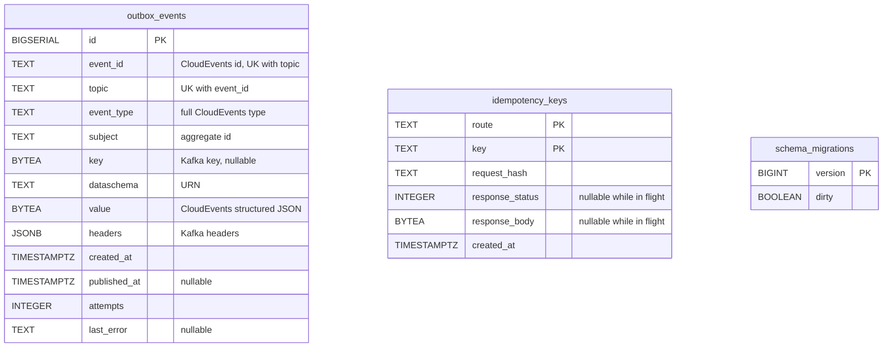

# Entity Relationship

The Postgres schema of the context's own database (no other context shares a
table). It is created by three migrations embedded in the `api` binary and
applied at start-up: `0001_node_topology_schema`, `0002_outbox_and_idempotency`
and `0003_profile_inbound_limits`. Every aggregate row carries `version`, the
optimistic-concurrency counter: a save is `UPDATE ... WHERE version = <loaded
version>`.

Eight tables exist: `regions`, `nodes`, `node_profile_revisions`, `lanes` and
`service_areas` (domain state), `outbox_events` and `idempotency_keys`
(infrastructure) and `schema_migrations` (golang-migrate's bookkeeping).

## Domain tables

Source: `internal/adapters/outbound/postgres/migrations/0001_node_topology_schema.up.sql`
and `0003_profile_inbound_limits.up.sql`.

Notes on the diagram:

- `OCC` marks the optimistic-concurrency counter; `UK` the unique key.
- The foreign keys are real and cross aggregates: `nodes.region_id`,
  `lanes.origin_node_id` / `destination_node_id`,
  `service_areas.delivery_station_node_id` and `service_areas.region_id` all
  `REFERENCES` their table. The rules that need another aggregate's *state*
  (both lane ends `ACTIVE`, the station `ACTIVE`, the region defined) are
  checked by the use case; the key only guarantees the row exists.
- `nodes (vendor_id, vendor_node_code)` is a **partial unique index**,
  `nodes_vendor_ref_key ... WHERE vendor_id IS NOT NULL`; it backs
  `ErrVendorNodeCodeTaken`. Network-run nodes carry no vendor reference. A
  `CHECK` (`nodes_vendor_ref_complete`) says the two columns are both set or
  both null; `nodes_geo_complete` does the same for `lat` and `lon`.
- `regions.code` is unique through the constraint `regions_code_key`
  (`ErrRegionCodeTaken`).
- `lanes_one_open_key` is a partial unique index on
  `(origin_node_id, destination_node_id, mode) WHERE status = 'OPEN'`
  (`ErrDuplicateLane`; Mermaid cannot draw a partial key). `lanes_no_loop`
  backs `ErrLaneLoop` and `lanes_closed_at_matches_status` ties `closed_at` to
  `status = 'CLOSED'`.
- Other indexes: `nodes (region_id)`, `nodes (node_type, status)`,
  `lanes (destination_node_id)`, `service_areas (delivery_station_node_id)`
  and `service_areas (region_id)`.
- Capabilities are not stored: they are derived from `node_type` on load
  (`DefaultCapabilitiesByType`).
- A profile revision is one **row**, not a table group: operating hours,
  holidays, cutoffs and the optional inbound limits are JSONB columns of
  `node_profile_revisions`. The throughput cap is three columns
  (`throughput_value`, `throughput_time_unit`, `throughput_unit`).

### Append-only profile history and the deferred pointer

`node_profile_revisions` is insert-only. The trigger function
`node_profile_revisions_append_only` raises `integrity_constraint_violation` on
every `UPDATE` or `DELETE`, so an old revision cannot be edited. The `nodes`
row holds only the current snapshot: `nodes.profile_revision` points at the
highest revision through the foreign key `nodes_current_profile_fkey` on
`(id, profile_revision)`, declared `DEFERRABLE INITIALLY DEFERRED` because the
node row is written before the revision row in the same transaction. Migration
`0003` added the nullable `inbound` column (`NULL` means no limits declared,
which is what every earlier revision keeps).

There is no assignment-history table: `service_areas` keeps only the current
assignment per postal prefix, with `assignment_version`; earlier assignments
exist only as `ServiceAreaAssigned` events.

## Infrastructure tables

Source: `internal/adapters/outbound/postgres/migrations/0002_outbox_and_idempotency.up.sql`;
`schema_migrations` is created by golang-migrate (`internal/adapters/outbound/postgres/migrate.go`).

These tables are infrastructure, not domain state:

- `outbox_events` is written in the same transaction as the aggregate and
  drained by the relay. `event_id` is the CloudEvents `id`, minted once and
  stored, so a relay retry republishes the same `id`; `(event_id, topic)` is
  unique. The partial index `idx_outbox_events_unpublished ON (id) WHERE
  published_at IS NULL` keeps the relay's scan on the unpublished tail, and a
  row stops being claimed once `attempts` reaches `OUTBOX_MAX_ATTEMPTS`. The
  migration comment names a second topic suffix `.analytics`; nothing is ever
  written to it.
- `idempotency_keys` is keyed by `key` alone. A repeat with the same
  `request_hash` replays the stored response; a different hash is the problem
  `idempotency-key-reused`. `response_status` and `response_body` are null
  while the first request is still in flight. Rows live 24 hours; the cleanup
  deletes where `created_at < now() - interval '24 hours'`.
- There is **no inbox table** (`processed_events`): the context consumes no
  topic.

## Read-model tables

None. The four query routes read the aggregate tables directly.

## Table and aggregate

| Table | Aggregate / role | Notes |
| --- | --- | --- |
| `nodes` | **Node** (root) | One row per node, the current snapshot, saved with a `version` check. |
| `node_profile_revisions` | **Node** (its `OperationalProfile` revisions) | Insert-only, enforced by a trigger; `nodes.profile_revision` points at the latest. |
| `lanes` | **Lane** | One row per lane; a closed lane is never reopened. |
| `service_areas` | **ServiceArea** | One row per postal prefix, holding the current assignment. |
| `regions` | **Region** | One row per region. |
| `outbox_events` | none (infrastructure) | Transactional outbox. |
| `idempotency_keys` | none (infrastructure) | `Idempotency-Key` replay store, keyed by `key`, 24-hour TTL. |
| `schema_migrations` | none (infrastructure) | Migration bookkeeping. |
