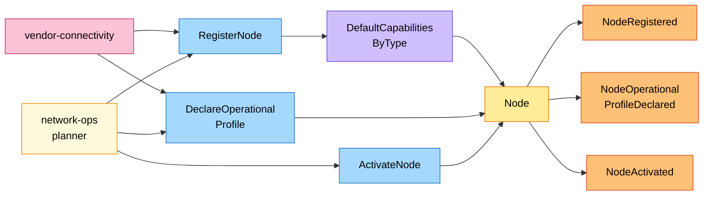
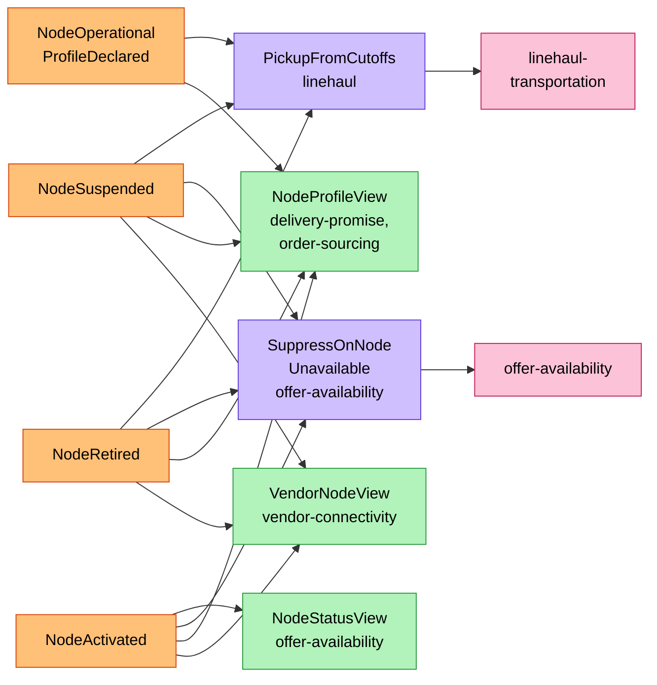
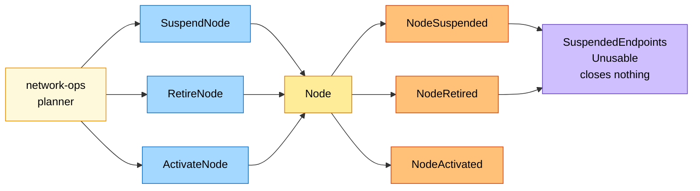
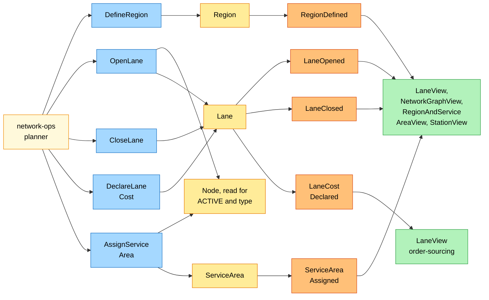

# EventStorming

Process-level boards in the ddd-crew
[EventStorming glossary & cheat sheet](https://github.com/ddd-crew/eventstorming-glossary-cheat-sheet)
notation. Every sticky comes from the code: the commands are the use cases in
`internal/application/usecases`, the events those in `internal/domain/*/events.go`;
the neighbours' policies and read models come from the network model. A hotspot
would be an open question or a risk; none is open for this context today (see
the end of the page). The domain-wide board is
[EventStorming big picture](https://iqvo.github.io/warehouse-docs/network/strategic-design/eventstorming-big-picture).

## Legend

| Colour | Sticky | Meaning here |
| --- | --- | --- |
| Blue `#a5d8ff` | Command | A command use case |
| Yellow `#ffec99` | Aggregate | `Node`, `Lane`, `ServiceArea`, `Region` |
| Orange `#ffc078` | Domain Event | One of the ten published events |
| Lilac `#d0bfff` | Policy | This context's policy or a neighbour's reaction |
| Green `#b2f2bb` | Read Model | A neighbour's event-fed read model |
| Pink `#fcc2d7` | External System | Another bounded context |
| Red `#ff8787` | Hotspot | An open question or risk |
| Pale yellow `#fff9db` | Actor | A person (the network-ops planner) |

## 1. A node is registered, declared and activated

Source: `internal/domain/node/events.go`, `internal/domain/lane/events.go`, `internal/domain/servicearea/events.go`, `internal/domain/region/events.go`, `internal/application/usecases/*.go`.

Omitted: the refusals (`ErrOperatorNotAllowedForNodeType`,
`ErrVendorNodeCodeTaken`, `ErrStaleProfileRevision`,
`ErrCutoffOutsideOperatingHours`, `ErrIncompleteOperationalProfile`,
`region.ErrUnknownRegion`, `ErrSubtypeNotAllowed`, `ErrSortDwellNotAllowed`,
`ErrInboundLimitsNotAllowed`), which
raise no event; the downstream reactions, on board 2.

## 2. What the network does with node facts

Source: `internal/domain/node/events.go`, `internal/domain/lane/events.go`, `internal/domain/servicearea/events.go`, `internal/domain/region/events.go`, `internal/application/usecases/*.go`.

Omitted: `NodeRegistered` feeding the same read models (and `StationView` in
`last-mile-delivery`); `node-performance`, which consumes `NodeRegistered` and
`NodeOperationalProfileDeclared` without effect (its handlers write only the inbox row);
`seller-inbound`, which keeps its `NodeInboundView` from the five node events.

## 3. Suspension and retirement

Source: `internal/domain/node/events.go`, `internal/domain/lane/events.go`, `internal/domain/servicearea/events.go`, `internal/domain/region/events.go`, `internal/application/usecases/*.go`.

The policy `SuspendedEndpointsUnusable` is this context's: the node's `OPEN`
lanes and `ASSIGNED` service areas stay as they are, and consumers treat them
as unusable while the node is not `ACTIVE`.

Omitted: `ErrNodeRetired` (any command on a `RETIRED` node) and
`ErrIllegalTransition` (any other command outside the transition table); the reasons a
planner suspends (free text of at most 500 characters; `node-performance` never
suspends a node).

## 4. Lanes, regions and service areas

Source: `internal/domain/node/events.go`, `internal/domain/lane/events.go`, `internal/domain/servicearea/events.go`, `internal/domain/region/events.go`, `internal/application/usecases/*.go`.

Omitted: the refusals (`ErrLaneLoop`, `ErrLaneTypePairNotAllowed`,
`ErrLaneEndpointNotActive`, `ErrDuplicateLane`, `ErrNotADeliveryStation`,
`ErrStaleAssignmentVersion`, `region.ErrUnknownRegion`, `ErrRegionCodeTaken`). The `Node` sticky here
is read, not changed: the lane and service-area use cases load it to check
their invariants.

## Hotspots

None. The hotspots of the earlier design are answered in the code and
stated in the pages of this pack:

- lanes and service areas of a node that leaves service: policy
  `SuspendedEndpointsUnusable`;
- who declares a network node's profile: the network-ops planner, with
  `declaredBy` `NETWORK_OPS`;
- cutoff days: `CutoffSlot.Days`, default every operating day;
- a later revision of an `ACTIVE` fulfillment centre: it keeps at least one
  cutoff and a `HandlingTimeMinutes` above zero (`ErrIncompleteOperationalProfile`);
- region membership: `region.ErrUnknownRegion`;
- illegal transitions and unknown ids: the shared `ErrIllegalTransition` and
  `ports.ErrNotFound`.
