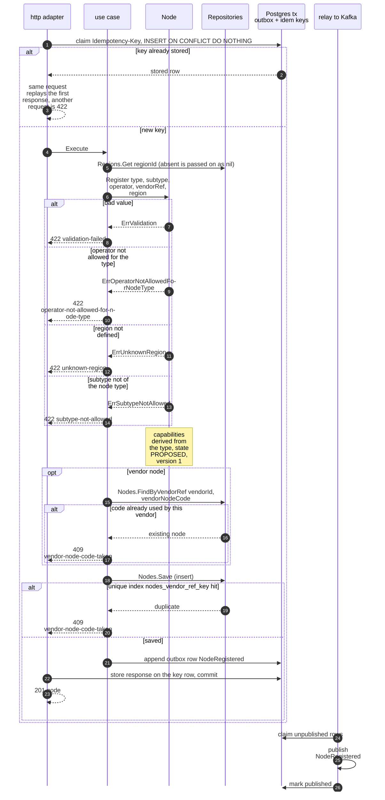
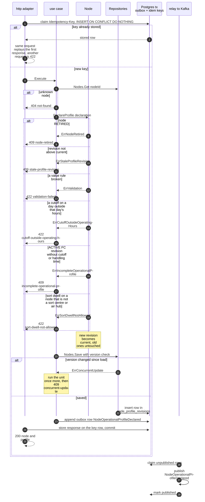
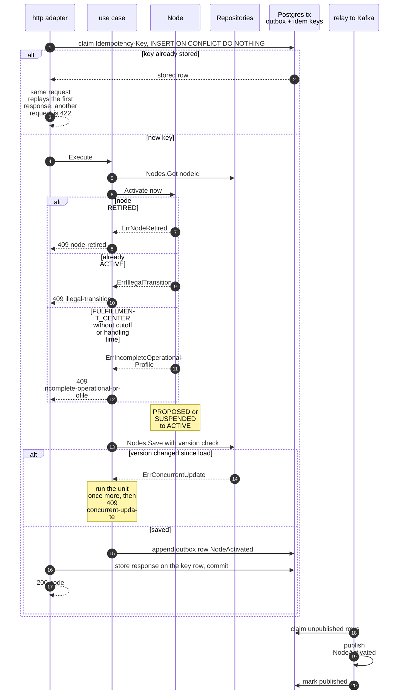
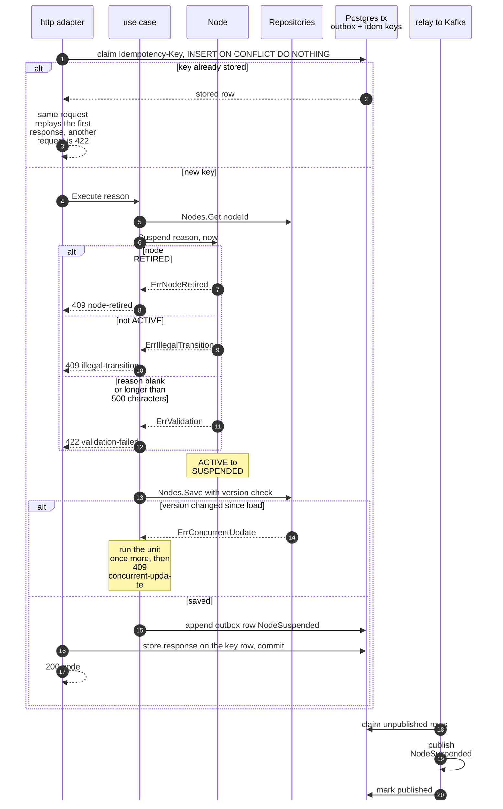
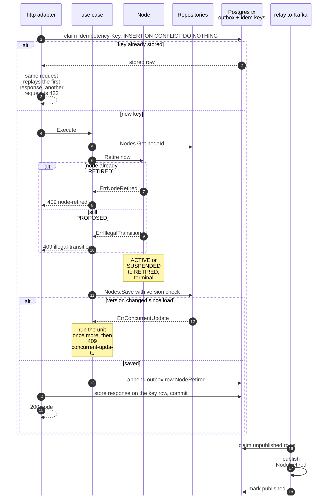
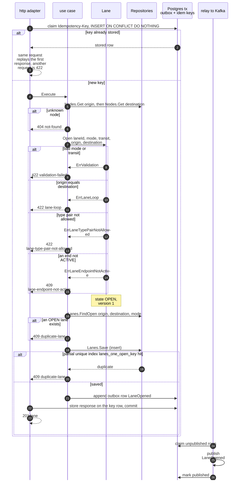
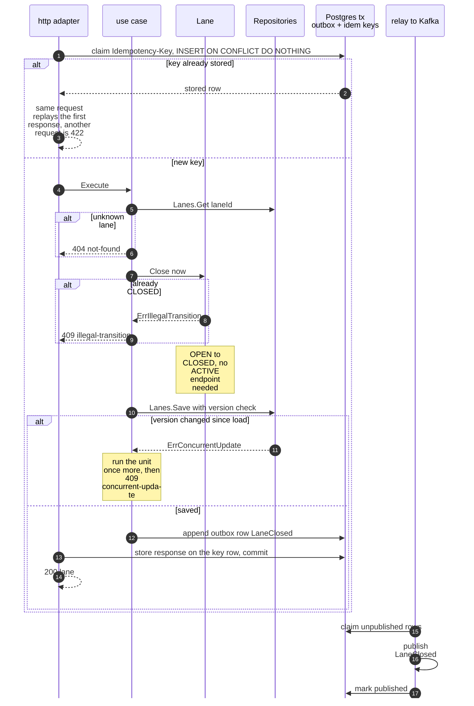
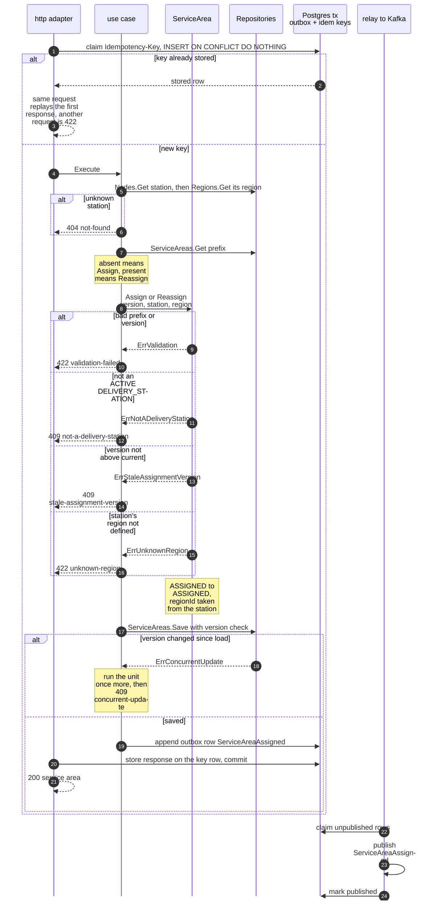
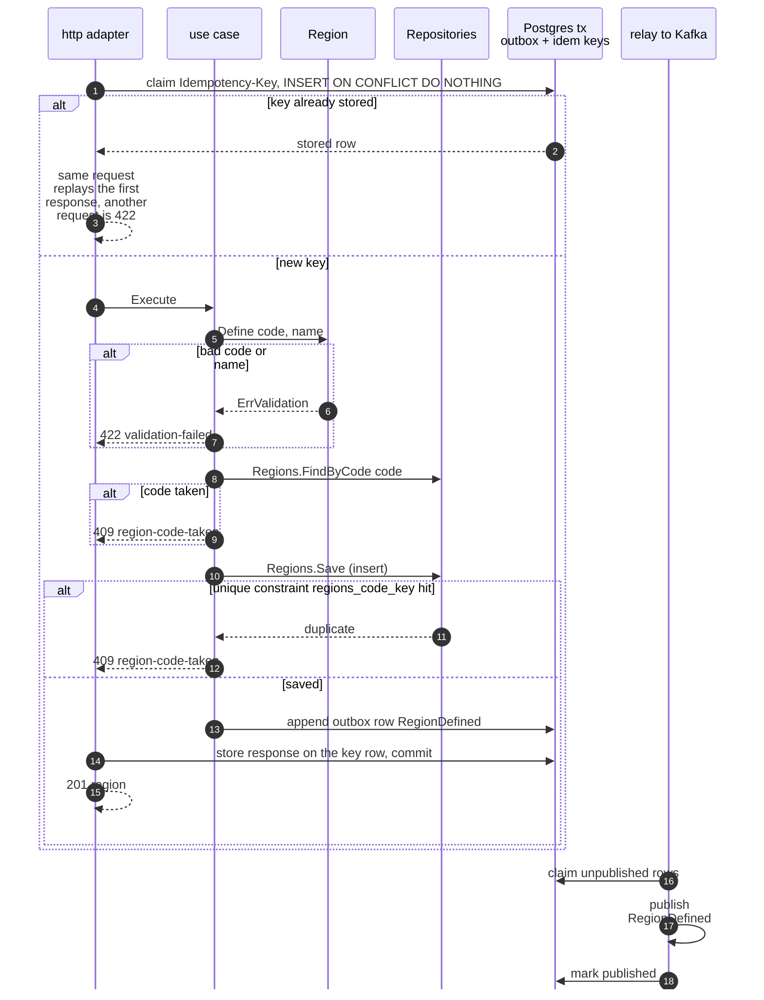

# Sequence Diagrams

One UML sequence diagram per command use case of the service. The participants
are the same in every diagram:

| Participant | Package |
| --- | --- |
| http adapter | `internal/adapters/inbound/http`, including the `Idempotency-Key` middleware |
| use case | `internal/application/usecases` |
| aggregate | `internal/domain/node`, `lane`, `servicearea` or `region` |
| Repositories | `internal/adapters/outbound/postgres` behind `internal/application/ports` |
| Postgres tx | the one transaction the middleware opens: the key row, the aggregate rows and `outbox_events` |
| relay to Kafka | `internal/adapters/outbound/outbox` and `outbound/kafka`, publishing to `retailnetwork.node-topology.events` |

Every state-changing route requires an `Idempotency-Key` header (`400
idempotency-key-required` without one). The middleware opens a transaction,
claims the key and runs the handler inside a savepoint of it, so the key,
the aggregate rows and the outbox rows of a 2xx commit together. The same key
with the same request replays the first answer (header `Idempotency-Replayed:
true`), the same key with another request is `409 idempotency-key-reused`. A 4xx
is stored too, a 5xx rolls everything back and is not stored. Each diagram shows
the optimistic-concurrency version check (or the unique index that backs a
create), the outbox write and the relay. When the version check fails the use
case runs the whole unit once more on fresh state and only then answers `409
concurrent-update`. A domain error writes nothing and publishes nothing. The
problem `type` slugs match [Use cases](/docs/ddd/use-cases). Path parameters are
written without braces in the diagrams.

## 1. RegisterNode

`POST /nodes`, published type `com.retailnetwork.logistics.node-topology.node.NodeRegistered`.

Source: `internal/adapters/inbound/http/idempotency.go`, `internal/application/usecases/nodes.go`, `internal/domain/node/node.go`, `internal/adapters/outbound/postgres/outbox_drain.go`, `internal/adapters/outbound/outbox/relay.go`.

Omitted: a new node has no version to check, so the unique index on `(vendor_id, vendor_node_code)` takes that role and catches two concurrent registrations. A network node has no vendor reference and skips the lookup. The `Region` is read, never saved. Every registration attempt also increments the counter `topology.nodes.registered` with `outcome` and, on a rejection, `reason`.

## 2. DeclareOperationalProfile

`PUT /nodes/{nodeId}/operational-profile`, published type `com.retailnetwork.logistics.node-topology.node.NodeOperationalProfileDeclared`.

Source: `internal/adapters/inbound/http/idempotency.go`, `internal/application/usecases/nodes.go`, `internal/domain/node/node.go`, `internal/domain/node/profile.go`, `internal/adapters/outbound/postgres/node_repository.go`.

Omitted: a node with no profile yet takes any first revision above zero. A `NETWORK` node refuses `declaredBy` `VENDOR` (`validation-failed`). Both `vendor-connectivity` (`declaredBy` `VENDOR`) and the network-ops planner (`declaredBy` `NETWORK_OPS`) call this route.

## 3. ActivateNode

`POST /nodes/{nodeId}/activations`, published type `com.retailnetwork.logistics.node-topology.node.NodeActivated`.

Source: `internal/adapters/inbound/http/idempotency.go`, `internal/application/usecases/nodes.go`, `internal/domain/node/node.go`, `internal/adapters/outbound/postgres/outbox_drain.go`.

Omitted: the 404 for an unknown `nodeId` (same as diagram 2).

## 4. SuspendNode

`POST /nodes/{nodeId}/suspensions`, published type `com.retailnetwork.logistics.node-topology.node.NodeSuspended`.

Source: `internal/adapters/inbound/http/idempotency.go`, `internal/application/usecases/nodes.go`, `internal/domain/node/node.go`, `internal/adapters/outbound/postgres/outbox_drain.go`.

Omitted: the 404 for an unknown `nodeId`; the downstream reactions (on [Domain Message Flow](/docs/ddd/domain-message-flow)).

## 5. RetireNode

`POST /nodes/{nodeId}/retirements`, published type `com.retailnetwork.logistics.node-topology.node.NodeRetired`.

Source: `internal/adapters/inbound/http/idempotency.go`, `internal/application/usecases/nodes.go`, `internal/domain/node/node.go`, `internal/adapters/outbound/postgres/outbox_drain.go`.

Omitted: the 404 for an unknown `nodeId`. The node's lanes and service areas are not touched (policy `SuspendedEndpointsUnusable`).

## 6. OpenLane

`POST /lanes`, published type `com.retailnetwork.logistics.node-topology.lane.LaneOpened`.

Source: `internal/adapters/inbound/http/idempotency.go`, `internal/application/usecases/lanes.go`, `internal/domain/lane/lane.go`, `internal/adapters/outbound/postgres/lane_repository.go`.

Omitted: the two `Node` aggregates are read, never saved.

## 7. CloseLane

`POST /lanes/{laneId}/closures`, published type `com.retailnetwork.logistics.node-topology.lane.LaneClosed`.

Source: `internal/adapters/inbound/http/idempotency.go`, `internal/application/usecases/lanes.go`, `internal/domain/lane/lane.go`, `internal/adapters/outbound/postgres/lane_repository.go`.

Omitted: nothing else; `CloseLane` touches no other aggregate.

## 8. AssignServiceArea

`PUT /service-areas/{postalPrefix}`, published type `com.retailnetwork.logistics.node-topology.servicearea.ServiceAreaAssigned`.

Source: `internal/adapters/inbound/http/idempotency.go`, `internal/application/usecases/servicearea.go`, `internal/domain/servicearea/servicearea.go`, `internal/adapters/outbound/postgres/service_area_repository.go`.

Omitted: the station `Node` and its `Region` are read, never saved. The first assignment of a prefix is a create (no version to check), later ones update the single `service_areas` row.

## 9. DefineRegion

`POST /regions`, published type `com.retailnetwork.logistics.node-topology.region.RegionDefined`.

Source: `internal/adapters/inbound/http/idempotency.go`, `internal/application/usecases/regions.go`, `internal/domain/region/region.go`, `internal/adapters/outbound/postgres/region_repository.go`.

Omitted: nothing else.
