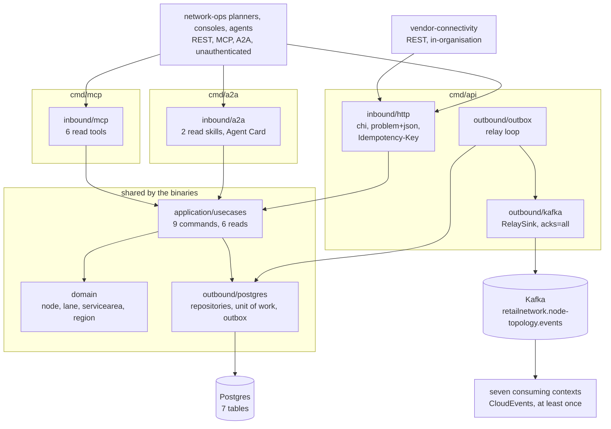

# Architecture

`node-topology` follows the fleet's hexagonal (ports and adapters) layout: dependencies point inward, the domain imports nothing from the rest of the module, and only `cmd/` wires the layers together. Everything on this page is on `develop`.

## Layout

| Layer | Path | Role |
| --- | --- | --- |
| Domain | `internal/domain/node` | `Node` aggregate with its immutable `OperationalProfile` revisions, `InboundLimits`, the type table (`typeRules`: operators, capabilities, subtypes) and the transition table; events `NodeRegistered`, `NodeOperationalProfileDeclared`, `NodeActivated`, `NodeSuspended`, `NodeRetired`. |
| Domain | `internal/domain/lane` | `Lane` aggregate, the allowed type pairs (`allowedPairs`), events `LaneOpened`, `LaneClosed`. |
| Domain | `internal/domain/servicearea` | `ServiceArea` aggregate keyed by `PostalPrefix`, event `ServiceAreaAssigned`. |
| Domain | `internal/domain/region` | `Region` aggregate, event `RegionDefined`. |
| Domain | `internal/domain/shared` | Event header, the shared errors (`ErrValidation`, `ErrIllegalTransition`, `ErrInvalidSnapshot`), id and text validators. |
| Application | `internal/application/usecases` | One use case per operation of `apis/openapi.yaml` (see [Use cases](/docs/ddd/use-cases)); `writer.go` holds the shared unit-of-work shape and the one-retry rule on `ErrConcurrentUpdate`; `register_metrics.go` records `topology.nodes.registered`. |
| Application | `internal/application/ports`, `repository`, `outbox`, `views` | The OUT ports (`NodeRepository`, `LaneRepository`, `ServiceAreaRepository`, `RegionRepository`, `EventOutbox`, `UnitOfWork`, `Clock`, `IDGenerator`, `NodeMetrics`), query filters, the already-encoded outbox `Message` and the read views. `ports` holds only interfaces. |
| Inbound adapter | `internal/adapters/inbound/http` | chi router for `apis/openapi.yaml`: handlers, RFC 9457 problem mapping (`problems.go`), the `Idempotency-Key` middleware, NUL rejection, `/healthz` and `/readyz`. No auth middleware. |
| Inbound adapter | `internal/adapters/inbound/mcp` | Six read-only MCP tools over Streamable HTTP; depends on application and domain only. |
| Inbound adapter | `internal/adapters/inbound/a2a` | The A2A JSON-RPC handler, the Agent Card and two read skills; same dependency rule. |
| Inbound adapter | `internal/adapters/inbound/requestlog` | The one-line access log with route pattern and trace ids. |
| Outbound adapter | `internal/adapters/outbound/postgres` | pgxpool repositories (`MaxConns` 10, `statement_timeout` 5 s), the unit of work (`pgtx`), the outbox repository and drain, trace propagation into outbox headers, embedded migrations. |
| Outbound adapter | `internal/adapters/outbound/outbox` | The relay loop that drains the outbox to a sink, with the attempt cap. |
| Outbound adapter | `internal/adapters/outbound/kafka` | `NewWriter` (acks=all, hash balancer, `AllowAutoTopicCreation`), the CloudEvents `Encoder`, `RelaySink` and `BrokerCheck` (the Kafka half of `/readyz`). |
| Outbound adapter | `internal/adapters/outbound/telemetry` | OTLP set-up, the `topology.nodes.registered` counter and the `slog` trace-context wrapper. |
| Outbound adapter | `internal/adapters/outbound/{clock,ids,memory}` | The production clock and UUID id generator; `memory` is an in-memory implementation of every port that serves unit and BDD tests only. The binaries never import it (`TestRuntimeBinaryHasNoInMemoryAdapters`). |
| Kafka envelope | `internal/adapters/kafka/cloudevents` | The only place a CloudEvents 1.0 envelope is built: `Repo` and `Context` `node-topology`, `Tier` `logistics`, `Source` `/retailnetwork/node-topology`, media type `application/cloudevents+json; charset=UTF-8`. |
| Support | `internal/bootretry` | Exponential-backoff retry for the first outbound dials at boot (5 attempts, 1, 2, 4, 8 s). |
| Composition roots | `cmd/api`, `cmd/mcp`, `cmd/a2a` | Env parsing, adapters, shutdown order. |
| Console remote | `web/` | The `node_topology_mfe` Module Federation remote ([ADR 0009](/docs/adr/0009-console-remote)); its own image and no database. |
| Test support | `internal/testing/{pgtest,kafkatest}`, `internal/adapters/outbound/repocontract` | Testcontainers helpers and the repository contract suite run against the memory and Postgres adapters. |
| Fitness tests | `internal/architecture` | Dependency rules and source-scanning sensors; see below. |

## Binaries and ports

| Binary | Role | Port | Probes |
| --- | --- | --- | --- |
| `cmd/api` | REST API, boot migrations and the outbox relay in one process, on real Postgres and Kafka. | `HTTP_ADDR`, default `:8080` | `GET /healthz` (liveness), `GET /readyz` (drain gate, Postgres ping, a Kafka broker answers a metadata request; never topics) |
| `cmd/mcp` | Read-only MCP server, Streamable HTTP at `/mcp` and `/`; Postgres only, no relay, no Kafka ([ADR 0008](/docs/adr/0008-mcp-server-adoption)). | `MCP_ADDR`, default `:8090` | `GET /healthz` |
| `cmd/a2a` | Read-only A2A agent: JSON-RPC at `/` and `/a2a`, Agent Card at `/.well-known/agent-card.json`; Postgres only ([ADR 0011](/docs/adr/0011-a2a-inbound-adapter)). | `A2A_ADDR`, default `:8093` | `GET /healthz` |

How `cmd/api` boots and in which order it stops is on [Runtime](/docs/overview/runtime) and the [runbook](/docs/operations/runbook); every variable is in [Configuration](/docs/operations/configuration).

## Container diagram

Source: `cmd/api/run.go` (`buildAdapters`, `buildServer`, `serveUntilSignal`), `cmd/api/relay.go`, `cmd/mcp/main.go`, `cmd/a2a/main.go` (`buildDeps`), `internal/adapters/inbound/http/server.go`, `internal/adapters/outbound/postgres/*`, `internal/adapters/outbound/outbox/relay.go`, `internal/architecture/architecture_test.go`. `cmd/mcp` wires only the six read use cases and `cmd/a2a` only three of them (`GetNode`, `ListNodes`, `ResolveServiceArea`); neither wires a write use case, so neither can append to the outbox.

## Data stores

One Postgres database, owned by the context and migrated by all three binaries on boot (`internal/adapters/outbound/postgres/migrations/`, [ADR 0003](/docs/adr/0003-no-consumed-contracts-and-ohs-reads)):

| Table | Holds |
| --- | --- |
| `regions` | One row per region; a unique index on `code`. |
| `nodes` | The Node aggregate row, including the lifecycle timestamps, the vendor reference (unique per vendor and code) and a pointer to the current profile revision. |
| `node_profile_revisions` | One immutable row per node and revision (append-only, enforced by a trigger); the optional `inbound` JSONB column was added in migration 0003. |
| `lanes` | The Lane aggregate; a partial unique index allows one `OPEN` lane per origin, destination and mode. |
| `service_areas` | One row per postal prefix with the current station, region and `assignment_version`. |
| `outbox_events` | The transactional outbox: the already-encoded CloudEvent, topic, key, headers, `attempts`, `last_error` and `published_at`. |
| `idempotency_keys` | Stored answers of keyed writes, primary key (`route`, `key`), purged after 24 h. |

Postgres is the only store: the service refuses to boot without `DATABASE_URL` and nothing is served from process memory. Kafka is the fleet's single broker; the api produces to `retailnetwork.node-topology.events` and consumes nothing. It never creates a topic through an admin API: the broker creates it on first write (the relay's writer allows auto-creation) and `/readyz` does not wait for any topic.

## Rules enforced by `internal/architecture`

The tests run on every pull request (`arch-test` job, `make arch-test`):

| Test | Rule |
| --- | --- |
| `TestHexagonalArchitecture` | The domain depends only on the domain; the application only on domain and application; inbound adapters do not depend on outbound adapters and vice versa; nothing under `internal/` imports `cmd`; `ports` holds only interfaces. |
| `TestMCPAdapterDependencyRule`, `TestMCPOptionalToolInputsCarryOmitempty` | The MCP adapter depends only on application and domain, nothing depends on it, and optional tool inputs carry `omitempty`. |
| `TestA2AAdapterDependencyRule`, `TestA2ASDKIsImportedByTheAdapterAndItsBinaryOnly`, `TestA2ADepsHoldReadUseCasesOnly`, `TestNoOutboundA2AClient` | The A2A adapter is inward-looking, its `Deps` hold read use cases only, and no file imports the A2A client: this context is delegated to and never delegates. |
| `TestNoAuthMiddlewareReintroduced` | No bearer, JWT or JWX code under `internal/adapters/inbound`: the surface is unauthenticated fleet-wide. |
| `TestRuntimeBinaryHasNoInMemoryAdapters`, `TestRuntimeBinaryDoesNotImportTheRepositoryContract` | No non-test file under `cmd/**` imports the memory adapters or the repository contract suite. |
| `TestCloudEventsOnly`, `TestNoEventEnvelopeToggleOrFlatEnvelope` | CloudEvents 1.0 is the only envelope. |
| `TestKafkaWritersSetRequiredAcks`, `TestKafkaWriterTopicNotSetTwice` | Every kafka-go `Writer` sets `RequiredAcks`, and no writer sets a topic when messages carry one. |
| `TestOutboxRelaysPassAttemptCap` | Every relay is built with `WithMaxAttempts`. |
| `TestEventCatalogueMatchesContract` | Every CloudEvents type that `apis/asyncapi.yaml` declares appears in the CloudEvents ADR ([ADR 0004](/docs/adr/0004-cloudevents-envelope-and-type-catalogue)). |
| `TestKafkaIntegrationTestsUseTestcontainers`, `TestPostgresIntegrationTestsUseTestcontainers` | Integration tests boot their own broker or database. |
| `TestNoGoFilesAtRepoRoot` | The module root holds no Go file. |

Commands and the full list are on [Testing](/docs/development/testing).
